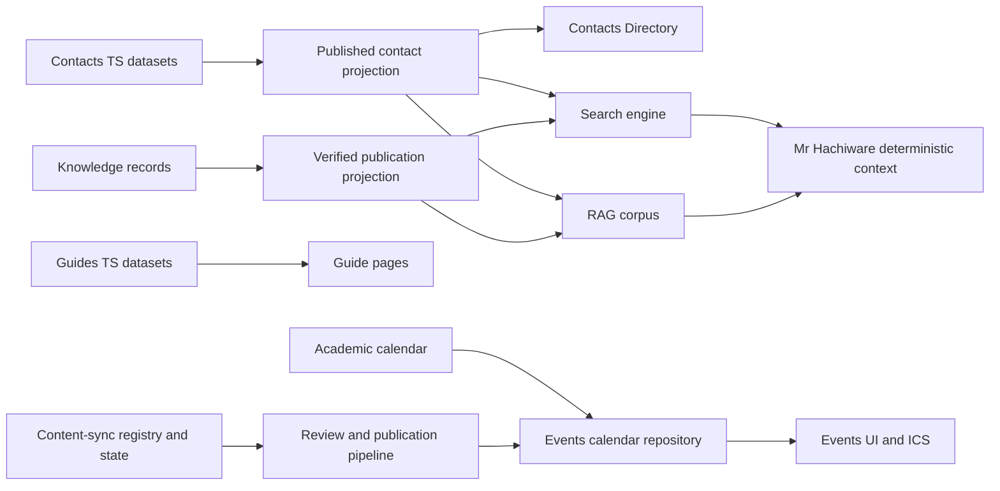

# DATA-001 — Canonical Data Architecture and Contacts Pilot

**Status:** READY FOR REVIEW
**Base SHA:** `490998dd9e01b46283bfc126ee4464a205a57203`
**Branch:** `data-001r-integration`
**Integrated commit before DATA-001R2:** `9f1c5826f6a56b99e53b7e807c25845054a1fa6f`
**Scope:** Backwards-compatible Contacts data pilot and publication-gating correction; no production, Events sync, database, CMS, Cloudflare, merge, or push changes.

## Why this pilot exists

The approved CI-001 base exposed three publication-consistency failures during DATA-001R:

- `doc-myrmit-submit-requests` was `needs_review` in the source array but was emitted as a verified RAG chunk.
- SSET specialized records marked `manual_review_required` were present in public contact projections, Search and RAG adapters.
- Student Connect deterministic campus answers did not consistently use the canonical published record, and the sync health target still checked a retired email.

The official RMIT sources checked for DATA-001 publish one Student Connect phone for both campuses: `+84 28 3776 1306`, extension 1. They publish the current walk-in locations and service hours but do not publish the `student.connect@rmit.edu.vn` address used by the old dataset.

Sources:

- [RMIT Student Connect](https://www.rmit.edu.vn/students/support/student-connect) — phone, extension, hours, Hanoi and Saigon South walk-in locations.
- [RMIT Contact Us](https://www.rmit.edu.vn/contact-us) — corroborates Student Connect phone and extension for both campuses.

Checked: `2026-11-20`; source version recorded as `rmit-student-connect-page-2026-11-20`.

## Current data flow

### Inventory

| Area | Current owner | Consumers | Provenance/publication | Risk |
|---|---|---|---|---|
| Contacts | `features/contacts/data/canonical.ts`, `departments.ts`, `academicSchools.ts`, `studentServices.ts` | Contacts UI, Search, RAG, Mr Hachiware, Facilities tests | Canonical source metadata plus `lastVerifiedDate`, URLs, specialized-contact review status; public projection keeps only verified specialized contacts | Remaining contact facts outside the pilot can still drift until migrated |
| Guides | `features/guides/data/guides.ts`, `extendedGuides.ts` | Guide list/detail pages, sitemap | Per-guide references and optional verification date | Free-form guidance can drift from Contacts; not all text should be mechanically normalized |
| Knowledge Base | `features/knowledge/data/documents.ts`, `schema.ts`, `indexManifest.ts` | Topic pages, Search, RAG, sitemap | `officialSourceUrl`, source title, verification date/status, static index version; public array contains verified records only | Review data remains source-controlled and requires an explicit publication decision |
| Academic Calendar | `features/academics/data/calendar.ts` | Events calendar repository, Events UI, ICS, RAG | Source PDF URL, verification date, published/verified event fields | Separate event domain; should not be folded into Contacts |
| Events | `features/events/data/calendar.ts`, event repository/presentation | Events UI, Search, ICS, RAG, Worker routes | Canonical event records with publication and verification status | Must retain existing deduplication and last-known-good behavior |
| Content sync | `features/content-sync/data/registry.ts`, `domain/types.ts`, monitor/store | Dynamic Events publication and review routes | `SourceState.lastGoodHash`, revisions, pending reviews, publication status | Sync is event-oriented; automatically publishing contact candidates would bypass review |
| Mr Hachiware | `features/assistant/application/gemini.ts`, `rag/corpus.ts` | Chat routes and provider context | Uses Contacts, Knowledge, RAG source registry | Inconsistent upstream records can produce contradictory answers |

### Existing local-only work

The original worktree is on `ci-001-sec-req-001-local` with pre-existing product, SEC-REQ-001, content-sync, Events, documentation, and test changes. Those changes remain independent and were not copied into this integration worktree. DATA-001R2 is based on approved CI-001 `490998...` plus DATA-001 at `9f1c582...`.

## Proposed minimal architecture

The pilot uses a typed, version-controlled repository. No database, CMS, external service, or new infrastructure is required.

### Canonical record schema

`features/contacts/data/canonical.ts` defines `CanonicalContact`:

| Field | Decision |
|---|---|
| `id` | Stable domain ID; pilot reuses `dept-student-connect` so existing consumers keep their identity |
| `entityType` | `contact` |
| `campusScope` | `all`, `saigon_south`, or `hanoi`, aligned with the existing shared `Campus` union |
| `name`, `location`, optional campus-specific `campusLocations`, `serviceHours` | Required English/Vietnamese values; campus-specific locations are selected by deterministic answers without changing the existing `location` shape |
| `phone`, `phoneInstruction`, `email` | Explicit nullable contact channels; absence is not inferred |
| `formUrl`, `websiteUrl` | Required HTTPS URLs |
| `source.urls` | One or more official RMIT HTTPS URLs |
| `source.verifiedAt` | ISO verification date |
| `source.sourceVersion` | Human-readable source snapshot/version identifier |
| `publication.status` | `published`, `review`, or `archived` |
| `publication.reviewStatus` | `approved`, `pending`, or `rejected` |

`validateCanonicalContacts()` validates required bilingual fields, campus locations, non-empty localized phone instructions, a phone whenever an instruction is present, stable IDs, official HTTPS RMIT hosts for public and source URLs, semantically valid ISO verification dates, source version, and publication values. Duplicate IDs are rejected. `getPublishedCanonicalContacts()` validates the candidate set and exposes only approved published records, while `selectLastKnownGoodCanonicalContacts()` preserves the prior approved record when candidates are still under review, incomplete, or invalid.

The static published array is the last-known-good public record. Future sync candidates must remain separate records with `review`/`pending` state; only validated, approved candidates can replace the matching published record. Existing content-sync remains event-only and is unchanged.

### Publication gating rules

- `ALL_KNOWLEDGE_DOCUMENTS` retains source-controlled review records; `KNOWLEDGE_DOCUMENTS` is the verified-only public projection. Search, topic pages, sitemap, RAG source registry, chunks and Mr Hachiware consume the projection.
- Public `DEPARTMENT_CONTACTS` and `ACADEMIC_SCHOOL_CONTACTS` projections remove `not_published` and `manual_review_required` specialized records. `REVIEW_ACADEMIC_SCHOOL_CONTACTS` preserves those records for internal review and regression evidence.
- Facility floors are public only when their optional status is absent or `verified`; Search, RAG chunks and hybrid retrieval apply the same boundary. A public adapter must not convert `needs_review`, `unavailable`, `manual_review_required` or `not_published` to `verified`. Last-known-good published records remain the only authoritative fallback.

### Ownership boundaries

- **Canonical Contacts:** `features/contacts/data/canonical.ts` owns selected institutional contact facts.
- **Compatibility adapters:** `departments.ts`, the Student Connect Knowledge document, the Student Connect guide, Student ID guidance, and Mr Hachiware deterministic answers read the canonical record while retaining existing public shapes and routes.
- **Published projections:** `features/knowledge/data/documents.ts` and `features/contacts/data/departments.ts` enforce the public boundary before Search, RAG, topic pages, sitemap, Contacts UI or assistant answers.
- **Search/RAG/Assistant:** continue consuming their existing public boundaries. They receive canonical facts through the adapters; no API contract changes are required.
- **Academic Calendar and Events:** remain owned by their existing event/calendar repositories.
- **Unreviewed sync candidates:** are not imported into public Contacts, Search, Knowledge, or RAG datasets.

## Contacts vertical slice

Changed files:

- `features/contacts/data/canonical.ts` — typed canonical Student Connect record, campus-specific locations, validation and publication/LKG helpers.
- `features/contacts/data/departments.ts` — canonical Student Connect adapter plus verified-only specialized-contact projection.
- `features/contacts/data/academicSchools.ts` — separates review records from the public verified-only school projection.
- `features/contacts/public.ts` — exports canonical types and publication helpers without exposing review-only school records through the public projection.
- `features/knowledge/data/schema.ts` — central verified publication predicate.
- `features/knowledge/data/documents.ts` — separates `ALL_KNOWLEDGE_DOCUMENTS` review data from the verified-only `KNOWLEDGE_DOCUMENTS` public projection; Student Connect and Student ID guidance consume canonical facts.
- `features/knowledge/public.ts` — keeps the existing public document export name while publishing only verified records.
- `features/guides/data/guides.ts` — Student Connect walk-in guidance consumes canonical location data.
- `features/content-sync/application/knowledge-sync.ts` — replaces the retired Student Connect email health keyword and checks fetched page content; publication behavior is unchanged.
- `features/assistant/application/gemini.ts` — deterministic Hanoi/Saigon Student Connect answers, no-email handling and SSET manual-review fallback use approved facts.
- `features/assistant/rag/corpus.ts`, `features/assistant/rag/retrieval.ts` — preserve document status, filter review-only facility chunks/sources, and consume filtered contact records.
- `features/facilities/data/campusHours.ts`, `features/facilities/public.ts`, `features/facilities/components/FacilitiesDirectory.tsx`, `features/search/application/engine.ts` — share a verified floor/building projection for public facility UI/Search/RAG data.
- `features/contacts/__tests__/canonical-contacts.test.ts`, `features/knowledge/__tests__/publication-gating.test.ts`, `features/content-sync/__tests__/knowledge-sync.test.ts`, `features/assistant/__tests__/student-connect-canonical.test.ts`, `features/assistant/__tests__/hanoi-audit.test.ts`, `features/assistant/__tests__/rag-evaluation.test.ts`, `features/academics/__tests__/sset-recognition.test.ts`, `features/search/__tests__/engine.test.ts` — schema, publication, manual-review, facility, consumer-consistency, sync-health, email and deterministic-answer regressions.
- `docs/architecture/DATA-001-canonical-contacts.md` — audit, design, evidence, risks, and migration strategy.

No Events repository, `features/content-sync/data/registry.ts`, `features/content-sync/domain/types.ts`, Worker route, API route, Cloudflare configuration, or SEC-REQ-001 path was changed. The content-sync application edit only corrects the Student Connect health-check keyword.

## Verification evidence

Executed in the isolated worktree:
| Command | Result |
|---|---|
| `bun install --frozen-lockfile` | Passed; 313 installs checked, no dependency changes |
| `bun audit --audit-level=moderate --json` | Passed: `{}` |
| `bun run build:vinext` | Passed; existing Vinext `lucide-react` import-optimization and route-classification warnings remain |
| `bun run check` | Passed |
| `bun run test --config vitest.config.ts` | Passed: 34 files, 323 tests |
| Targeted DATA-001R2 tests | Passed: 7 files, 54 tests; final 2-file combined-campus/source-registry gate 8 tests; final facility publication/Search gate 27 tests |
| `bun run rag:validate` | Passed: no duplicate chunks, invalid URLs, invalid source URLs, or source mappings |
| `bun run rag:smoke` | Passed: five grounded official-source prompts; one general-advice prompt returned insufficient evidence |
| Throwaway RAG deterministic campus smoke | Passed: Hanoi and Saigon South English/Vietnamese answers used canonical locations and `+84 28 3776 1306 — Press 1` / `Nhấn phím 1` |

The checks above ran in `r-students-data-001r` on the integrated local branch. They validate local source and generated artifacts only; no production deployment, Cloudflare configuration, remote push, merge, or production Events sync was performed.

## Residual risks

1. The pilot canonicalizes Student Connect and adds a reusable verified-only publication boundary; other institutional facts in Guides, Academic Calendar and free-form Knowledge text remain migration candidates.
2. Static canonical records still require deliberate source review; no automatic contact ingestion was introduced.
3. The integrated Hono dependency audit passed at the approved CI-001 base; this does not alter production deployment state.
4. The Student Connect content-sync health target now checks the official page keyword, but the sync implementation still does not publish contact candidates.
5. Conflicting school-specific facts remain explicitly manual-review content in source control and are excluded from public Contacts, Search, Knowledge and RAG projections.
6. Provider-output validation, citation enforcement and response-cache safety are separate security findings, not SEC-REQ-001's byte-bounded request-body parsing task and not implemented by DATA-001R2.
7. The original dirty worktree remains independent and must not be merged from this branch without a separate scope review.

## Follow-up migration strategy

1. **Guides:** identify only institutional contact/location/hour facts, move those to canonical records, and leave editorial advice as guide-owned text.
2. **Knowledge Base:** add canonical references to contact-bearing documents while keeping summaries and procedures editorially reviewable; update the static index version when approved records change.
3. **Academic Calendar:** preserve the existing calendar/event repository and add shared provenance helpers only in a separate slice; do not merge calendar facts into Contacts.
4. **Content sync:** if contact monitoring is ever proposed, store candidates and revisions separately, require review, and retain the last approved static record on failed or incomplete fetches.
5. **Mr Hachiware/Search/RAG:** keep consuming public adapters and add consistency tests for each migrated entity rather than introducing a second fact store.
