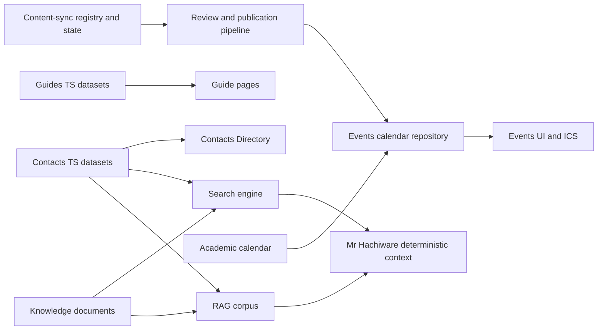

# DATA-001 — Canonical Data Architecture and Contacts Pilot

**Status:** NEEDS CHANGES
**Base SHA:** `298d761b0344aa1377d42d521fee9322025fee02`
**Branch:** `data-001-contacts-pilot`
**Scope:** Backwards-compatible Contacts data pilot; no production, Events sync, database, CMS, Cloudflare, merge, or push changes.

## Why this pilot exists

The cached remote `main` contains conflicting Student Connect facts:

- `features/contacts/data/departments.ts` publishes `+84 28 3776 1306`.
- `features/knowledge/data/documents.ts` publishes `+84 28 3776 1300` for Saigon and `+84 24 3726 1460` for Hanoi, plus `student.connect@rmit.edu.vn`.
- `features/guides/data/guides.ts` repeats generic walk-in locations without the current official wording.

The official RMIT sources checked for DATA-001 publish one Student Connect phone for both campuses: `+84 28 3776 1306`, extension 1. They publish the current walk-in locations and service hours but do not publish the `student.connect@rmit.edu.vn` address used by `main`.

Sources:

- [RMIT Student Connect](https://www.rmit.edu.vn/students/support/student-connect) — phone, extension, hours, Hanoi and Saigon South walk-in locations.
- [RMIT Contact Us](https://www.rmit.edu.vn/contact-us) — corroborates Student Connect phone and extension for both campuses.

Checked: `2026-11-20`; source version recorded as `rmit-student-connect-page-2026-11-20`.

## Current data flow

### Inventory

| Area | Current owner | Consumers | Provenance/publication | Risk |
|---|---|---|---|---|
| Contacts | `features/contacts/data/departments.ts`, `academicSchools.ts`, `studentServices.ts` | Contacts UI, Search, RAG, Mr Hachiware, Facilities tests | `lastVerifiedDate`, URLs, specialized-contact status | Fact duplication across documents and guides; no shared record identity before this pilot |
| Guides | `features/guides/data/guides.ts`, `extendedGuides.ts` | Guide list/detail pages, sitemap | Per-guide references and optional verification date | Free-form guidance can drift from Contacts; not all text should be mechanically normalized |
| Knowledge Base | `features/knowledge/data/documents.ts`, `schema.ts`, `indexManifest.ts` | Topic pages, Search, RAG, sitemap | `officialSourceUrl`, source title, verification date/status, static index version | Contact facts were duplicated in document text and had a contradictory phone |
| Academic Calendar | `features/academics/data/calendar.ts` | Events calendar repository, Events UI, ICS, RAG | Source PDF URL, verification date, published/verified event fields | Separate event domain; should not be folded into Contacts |
| Events | `features/events/data/calendar.ts`, event repository/presentation | Events UI, Search, ICS, RAG, Worker routes | Canonical event records with publication and verification status | Must retain existing deduplication and last-known-good behavior |
| Content sync | `features/content-sync/data/registry.ts`, `domain/types.ts`, monitor/store | Dynamic Events publication and review routes | `SourceState.lastGoodHash`, revisions, pending reviews, publication status | Sync is event-oriented; automatically publishing contact candidates would bypass review |
| Mr Hachiware | `features/assistant/application/gemini.ts`, `rag/corpus.ts` | Chat routes and provider context | Uses Contacts, Knowledge, RAG source registry | Inconsistent upstream records can produce contradictory answers |

### Existing local-only work

The original worktree is on `ci-001-sec-req-001-local` with pre-existing product, SEC-REQ-001, content-sync, Events, documentation, and test changes. Those changes are not present in cached remote `main` and were not copied into this worktree. The pilot is based only on `origin/main` at `298d761...`.

## Proposed minimal architecture

The pilot uses a typed, version-controlled repository. No database, CMS, external service, or new infrastructure is required.

### Canonical record schema

`features/contacts/data/canonical.ts` defines `CanonicalContact`:

| Field | Decision |
|---|---|
| `id` | Stable domain ID; pilot reuses `dept-student-connect` so existing consumers keep their identity |
| `entityType` | `contact` |
| `campusScope` | `all`, `saigon_south`, or `hanoi`, aligned with the existing shared `Campus` union |
| `name`, `location`, `serviceHours` | Required English/Vietnamese values |
| `phone`, `phoneInstruction`, `email` | Explicit nullable contact channels; absence is not inferred |
| `formUrl`, `websiteUrl` | Required HTTPS URLs |
| `source.urls` | One or more official RMIT HTTPS URLs |
| `source.verifiedAt` | ISO verification date |
| `source.sourceVersion` | Human-readable source snapshot/version identifier |
| `publication.status` | `published`, `review`, or `archived` |
| `publication.reviewStatus` | `approved`, `pending`, or `rejected` |

`validateCanonicalContacts()` validates required bilingual fields, non-empty localized phone instructions when present, stable IDs, official HTTPS RMIT hosts for public and source URLs, semantically valid ISO verification dates, source version, and publication values. Duplicate IDs are rejected. `getPublishedCanonicalContacts()` validates the candidate set and exposes only approved published records, while `selectLastKnownGoodCanonicalContacts()` preserves the prior approved record when candidates are still under review, incomplete, or invalid.

The static published array is the last-known-good public record. Future sync candidates must remain separate records with `review`/`pending` state; only validated, approved candidates can replace the matching published record. Existing content-sync remains event-only and is unchanged.

### Ownership boundaries

- **Canonical Contacts:** `features/contacts/data/canonical.ts` owns selected institutional contact facts.
- **Compatibility adapters:** `departments.ts`, the Student Connect Knowledge document, the Student Connect guide, and the Mr Hachiware no-document fallback read the canonical record while retaining existing public shapes and routes.
- **Search/RAG/Assistant:** continue consuming their existing public boundaries. They receive canonical facts through the adapters; no API contract changes are required.
- **Academic Calendar and Events:** remain owned by their existing event/calendar repositories.
- **Unreviewed sync candidates:** are not imported into public Contacts, Search, Knowledge, or RAG datasets.

## Contacts vertical slice

Changed files:

- `features/contacts/data/canonical.ts` — new canonical schema, Student Connect record, validation, and publication filtering.
- `features/contacts/data/departments.ts` — Student Connect adapter; existing `DepartmentContact` shape preserved; unsupported direct Student Connect contact channels removed from the Finance routing record.
- `features/contacts/public.ts` — exports canonical types and publication/LKG helpers without removing existing Contacts exports.
- `features/knowledge/data/documents.ts` — Student Connect document now consumes canonical phone, extension, location, hours, source, and verification date; stale email and split phone facts removed while existing service guidance is retained.
- `features/knowledge/data/indexManifest.ts` — curated contact provenance and index version refreshed for the canonical source version.
- `features/guides/data/guides.ts` — Student Connect walk-in step consumes canonical hours/location/source and verification date while retaining the guide's editorial urgent-inquiry guidance.
- `features/assistant/application/gemini.ts` — no-document fallback and Hanoi Student Connect RAG routing consume canonical phone, instruction, and official URL.
- `features/assistant/rag/corpus.ts` — contact chunks include canonical phone instruction when present.
- `features/contacts/components/ContactsDirectory.tsx` — renders the canonical phone instruction beside the existing phone link when available.
- `features/contacts/__tests__/canonical-contacts.test.ts` — schema, duplicate, publication, URL/date-boundary, Search, Knowledge, Hanoi RAG, and consistency tests.
- `features/assistant/__tests__/hybrid-rag.test.ts` — static index version contract updated for the canonical index rebuild.
- `docs/architecture/DATA-001-canonical-contacts.md` — audit, design, evidence, risks, and migration strategy.

No Events, `features/content-sync/data/registry.ts`, `features/content-sync/domain/types.ts`, Worker route, API route, Cloudflare configuration, or SEC-REQ-001 path was changed.

## Verification evidence

Executed in the isolated worktree:

| Command | Result |
|---|---|
| `bun run test --config vitest.config.ts features/contacts/__tests__/canonical-contacts.test.ts` | Passed: 1 file, 3 tests |
| Targeted Contacts/Knowledge/Search/Facilities/RAG test command | Passed: 8 files, 111 tests |
| `bun run build:vinext` | Passed; existing Vinext import-optimization and route-classification warnings remain |
| `bun run check` after the generated build | Passed |
| `bun run test --config vitest.config.ts` | Passed: 31 files, 313 tests |
| `bun run rag:validate` | Passed: no duplicate chunks, invalid URLs, invalid source URLs, or source mappings |
| `bun run rag:smoke` | Passed: grounded official-source results for five prompts; one general advice prompt correctly returned insufficient evidence |
| Local `http://127.0.0.1:3000/contacts` preview | Passed: Student Connect phone and localized `Press 1` instruction rendered in the Contacts directory screenshot |
| `bun audit --audit-level=moderate --json` | Failed on inherited `hono@4.13.14` moderate advisories; the separate held CI-001 Hono remediation is not included by DATA-001 |

The first TypeScript check before the generated build failed because the baseline imports `dist/server/index.js`; the approved workflow builds before checking. The required build-then-check sequence passed.

## Residual risks

1. The pilot covers Student Connect only. Other contact-bearing facts remain in academic-school records, facilities data, free-form guides, and Knowledge documents.
2. Static canonical records still require deliberate source review; no automatic contact ingestion was introduced.
3. The inherited Hono audit failure remains until the separately held CI-001 remediation is approved and integrated.
4. The content-sync Knowledge health target still contains the legacy Student Connect email keyword; it was left unchanged to preserve existing sync behavior and should be migrated to an official-source assertion in a separate reviewed slice.
5. Some official pages contain conflicting school-specific facts. Those remain explicitly manual-review content and were not silently corrected.
6. Independent Security review identified broader pre-existing gaps in provider-output citation validation, stale Knowledge freshness gating, and exclusion of manual-review contact records from RAG; these are outside this limited pilot and remain follow-up work.
7. The original dirty worktree remains independent and must not be merged from this branch without a separate scope review.

## Follow-up migration strategy

1. **Guides:** identify only institutional contact/location/hour facts, move those to canonical records, and leave editorial advice as guide-owned text.
2. **Knowledge Base:** add canonical references to contact-bearing documents while keeping summaries and procedures editorially reviewable; update the static index version when approved records change.
3. **Academic Calendar:** preserve the existing calendar/event repository and add shared provenance helpers only in a separate slice; do not merge calendar facts into Contacts.
4. **Content sync:** if contact monitoring is ever proposed, store candidates and revisions separately, require review, and retain the last approved static record on failed or incomplete fetches.
5. **Mr Hachiware/Search/RAG:** keep consuming public adapters and add consistency tests for each migrated entity rather than introducing a second fact store.
