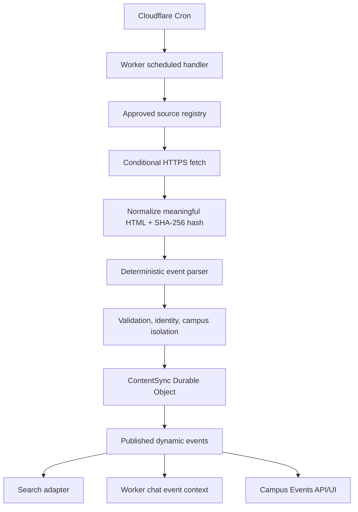

# Automated RMIT Content Monitoring

## Current architecture


The inspected `https://www.rmit.edu.vn/robots.txt` publishes `https://www.rmit.edu.vn/sitemap.xml` and Vietnamese sitemap URLs. No RSS feed or private event API was identified in the inspected public pages. The prototype uses explicit approved event landing pages and their verified detail links first; sitemap fan-out is a planned discovery enhancement, not an unrestricted crawl.
The existing static TypeScript corpus remains last-known-good content. Dynamic monitored events are stored separately so a failed fetch, parser change, or rollback cannot erase verified static records.

## Smart Automation v3 additions

- `lib/sync/quality.ts` provides configurable `CURRENT`, `REVIEW_DUE`, `STALE`, `SOURCE_UNAVAILABLE`, and `CONFLICTED` states plus field-level event date conflicts.
- Static RAG retrieval applies freshness penalties; dynamic events with stale/source-unavailable/conflicted status are excluded from current Search/RAG presentation.
- `/admin/sync` is a token-gated review UI backed by `/api/admin/sync`; approval, rejection, and rollback actions are server-authorized.
- `/api/events/:id/ics` provides timezone-aware `.ics` download only for confirmed published events.
- `/api/feedback` accepts bounded anonymous issue reports; reports are visible to administrators through the sync health response.
- `/api/updates` exposes only published new/updated revision summaries for the in-app Recent Updates panel.

## Source registry
## Campus Buzz forwarding

The Worker now exposes a protected relay endpoint:

```text
POST /api/ingest/campus-buzz
Authorization: Bearer <CAMPUS_BUZZ_INGEST_TOKEN>
```

Payload: `{ messageId?, from, subject, receivedAt?, text }`. Only `@rmit.edu.vn` senders, bounded text, and RMIT source links are accepted. Messages are queued for review; they are not published directly and are not sent to Gemini automatically.

The current `workers.dev` URL is not an Outlook mailbox. To make forwarding automatic, configure an approved relay (for example Power Automate/Microsoft Graph or a custom-domain email worker) to POST the forwarded message to the endpoint. This requires an approved token and an actual Outlook/custom-domain integration; no mailbox credentials are stored in R-Students.


`lib/sync/registry.ts` contains the approved registry. The active event prototype monitors:

- Student Activities and Events
- Student News and Events
- Student Events 2026
- General RMIT Events

The registry also records review-only sources for clubs, scholarships, Global Experience, academic calendar, procedures, and campus facilities. These sources use conditional fetches, normalized hashes, snapshots, and protected review queue entries when content changes; they are not auto-published until source-specific parsers are approved.

## Scheduling

The deployed production configuration keeps the existing daily cron at `0 2 * * *` (02:00 UTC) and sets `CONTENT_SYNC_ENABLED=true`. Event sources prefer 30-minute polling, but the current schedule intentionally limits production fetch volume until the event monitor has a longer healthy history.

For a reviewed higher-frequency rollout:

```jsonc
{
  "triggers": { "crons": ["*/30 * * * *"] },
  "vars": { "CONTENT_SYNC_ENABLED": "true" }
}
```

Cloudflare cron expressions are UTC. Event sources are configured for 30-minute polling; student news is 2 hours; clubs 6 hours; scholarships/global experience 12 hours; stable pages 24 hours.

## Change detection

1. Send `If-None-Match` and `If-Modified-Since` when stored.
2. Reject non-HTTPS/non-RMIT sources and responses over 2 MiB.
3. Remove scripts, styles, navigation, footer, header, forms, comments, and repeated whitespace.
4. Hash meaningful normalized content with SHA-256.
5. Return immediately on HTTP 304 or unchanged normalized hash.
6. Parse changed event sources; queue changed review-only sources for protected manual review.
7. Compare stable event identity and field hashes.
8. Write revisions only for new/updated/failed/review-required changes.

A date change keeps the same event identity when title and campus remain stable, so it becomes an update rather than a duplicate. Hanoi and Saigon South are separate identities.

## Persistence

`ContentSyncDurableObject` stores:

- Source states and conditional request metadata
- Last successful snapshots
- Published dynamic events
- Revision history
- Pending review items
- Recent sync run reports

The Worker binding is `CONTENT_SYNC_DO`; migration tag `v3` is present in `wrangler.jsonc`. `CONTENT_SYNC_ENABLED` is true in the deployed configuration.

## Automatic publication policy

Automatic publication requires:

- Approved source
- HTTPS canonical detail URL
- Complete title/date/identity
- Verified campus or explicit all-campus scope
- Valid category and registration URL, if present
- No parser review reason

Incomplete extraction, ambiguous campus, cancelled/postponed conflicts, or unfamiliar markup creates a review item and preserves the previous published event.

Temporary HTTP failure never deletes events.

## Search, RAG, and UI integration

- `GET /api/events` exposes published dynamic events only; it is read-only public content, not a sync endpoint.
- Worker Search merges dynamic event results with the static search corpus.
- Worker Mr Hachiware merges dynamic event evidence with the existing event context using the same canonical source URL.
- `CalendarExplorer` fetches `/api/events` and deduplicates records by canonical event ID.
- Dynamic events use stable IDs and source URLs; changed records are not re-embedded through the static corpus path. A future Vectorize adapter can embed only changed dynamic chunks using the existing `EmbeddingProvider` contract.
- `/api/sync` is protected. `/api/admin/sync` requires the existing `EVENT_ADMIN_TOKEN` and supports health (`GET`) and a protected controlled run (`POST`).

## Tests and controlled validation

```bash
npx vitest run --config vitest.config.ts tests/content-sync.test.ts
npm run check
npm run rag:validate
npm run rag:smoke
```

`tests/content-sync.test.ts` covers new events, date updates, no-change behavior, campus separation, source failure retention, and incomplete extraction review.

## Operational report

Admin status includes source state, error counts, review items, and recent runs. The monitor logs no page body, credentials, cookies, or student conversation content. Repeated failures remain in DO health state for external alerting integration; no paid notification service is enabled.

## Cost and limits

The active prototype adds no Gemini calls and no embedding calls. Cost is limited to scheduled Worker execution, Durable Object storage operations, and source egress/fetch activity. The implementation bounds each response at 2 MiB, fetch timeout at 10 seconds, registry sources at 20 per run, and history at 500 revisions/reviews. Current limits and account pricing must be checked before enabling 30-minute production polling.

No D1, Queue, Workflow, R2, or Vectorize resource is required for this prototype. Workflows/Queues become justified only if parsing duration, retry volume, or source count exceeds a single scheduled Worker execution window.

## Rollback

1. Set `CONTENT_SYNC_ENABLED=false`.
2. Keep static calendar/search/RAG records active.
3. Do not delete the Durable Object state.
4. Review revisions and pending items through `/api/admin/sync`.
5. Re-enable only after parser/source fixes pass controlled tests.

## Remaining limitations

- Event extraction intentionally supports a conservative HTML fixture/page shape; it does not claim to understand every RMIT layout.
- RSS, sitemap, and structured-data discovery was not enabled because no verified supported feed/API contract was found in the repository. Registry URLs are explicit and allowlisted.
- Clubs, scholarships, calendar, procedure, and campus-facility sources are monitored in review-only mode; automatic publication still requires source-specific parsers and fixtures.
- The current UI fetches dynamic event data but cannot show server-side dynamic events in static Next prerender output until the API request resolves.
- Production deployment completed with event monitoring enabled; non-event publication remains review-gated.
