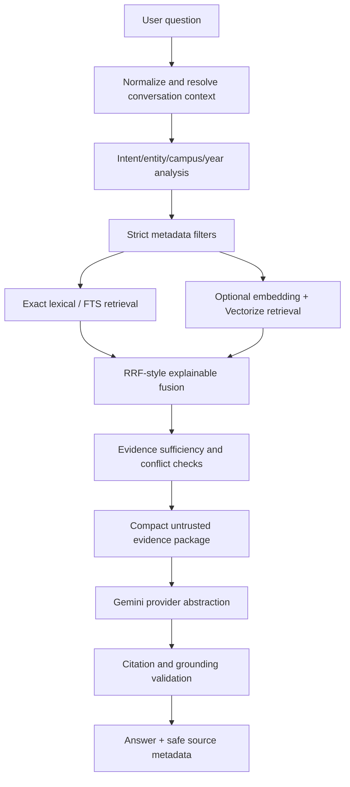

# Mr Hachiware RAG Architecture Assessment

## Existing system

- **Frontend:** Next.js App Router / React, built for Cloudflare Workers with Vinext. `features/assistant/components/ChatWidget.tsx` is a responsive, bilingual client widget.
- **Public API paths:** `app/api/chat/route.ts` is a thin local/Next adapter and `worker/index.ts` composes the deployed Worker router. Both use the feature-owned assistant application.
- **Generation:** `@google/genai`, Gemini model selected by `GEMINI_MODEL`; Worker optionally uses the existing Workers AI binding.
- **Quota:** `durable-objects/ai-quota.ts` is the deployed atomic 10-question/day store. The Next route currently falls back to process memory and is not equivalent to production.
- **Knowledge:** curated TypeScript records for policies, contacts, facilities/floor plans, clubs/recruitment, events/calendar, scholarships, global experience, and guides. `features/knowledge/data/indexManifest.ts` is the existing static source boundary.
- **Search:** `features/search/application/engine.ts` performs bilingual diacritic-insensitive weighted lexical matching with campus/category filters and auxiliary structured records. It is useful exact-match infrastructure but does not expose chunk IDs, evidence states, or provider-independent retrieval contracts.
- **PDFs:** no checked-in PDF files. Floor-plan URLs and manually reviewed page/room facts are stored in `features/facilities/data/campusHours.ts`; records explicitly mark `needs_review` and `conflicting` facts.
- **Security:** server-side secrets, signed anonymous cookie, request-size limits, scope checks, rate controls, CSP/security headers, and an authenticated event-review endpoint already exist.

## Architecture decision

### Option A — Vectorize + D1 hybrid

Best retrieval ceiling for multilingual paraphrases and exact identifiers when Vectorize, D1, embedding jobs, migrations, and operational indexes are provisioned. It adds bindings, resource lifecycle, embedding cost, dimension/model migration, and a production indexing job. It is not currently deployable because the repository has no D1/Vectorize bindings or migration state.

### Option B — D1/FTS-compatible lexical retrieval with selective semantic enhancement (**chosen**)

Keep curated TypeScript records authoritative, convert them to stable chunks at build/runtime, and use the existing high-quality exact lexical search plus deterministic query analysis. Add a D1 FTS5 schema and Vectorize/Workers AI adapter behind interfaces for an opt-in migration. This is the lowest-risk path for the current small corpus and preserves exact room codes, dates, emails, and URLs without requiring a new paid resource. Semantic enhancement can be enabled only after model/dimension/index validation.

### Option C — External vector database

Rejected: unnecessary vendor, network, and secret surface for this student-run Worker deployment.

## Retrieval flow

## Boundaries

1. `platform/rag/types.ts`: stable contracts for chunks, sources, query analysis, retrieval, evidence, providers, and diagnostics.
2. `features/assistant/rag/corpus.ts`: adapters for existing structured records; no duplicate manually maintained database.
3. `features/search/application/query.ts`: deterministic bilingual normalization, intent, entity, campus, temporal and exact-identifier extraction.
4. `features/assistant/rag/retrieval.ts`: lexical retrieval now; optional embedding/vector adapters later; strict campus/year filters.
5. `features/assistant/rag/evidence.ts`: source allow-list, authority ordering, conflict and sufficiency classification, compact context construction.
6. `platform/rag/providers.ts`: Gemini primary, Workers AI fallback adapter, and embedding abstraction. Providers never own indexing or retrieval.
7. `platform/rag/ingestion.ts`: idempotent chunk hashing, structured adapters, text/PDF page ingestion boundary, stale-record reporting, and D1 migration output.
8. `features/assistant/rag/chat-service.ts`: one orchestration contract shared by both API surfaces.

## Cost/latency estimate

Current static corpus is small enough to keep in the Worker bundle/cache; lexical retrieval is local and avoids per-query embedding cost. The optional semantic path costs one embedding call per query plus index storage and should be measured only after a representative evaluation set exists. Gemini remains the only generation allowance charged to the visitor. No D1, Vectorize, R2, or paid fallback resource is provisioned by this change.

## Security boundaries

- Provider credentials remain Worker bindings; never serialized to the client.
- Retrieved content is data, not instructions; prompt-injection text is delimited and ignored as authority.
- Source URLs are accepted only from verified HTTPS RMIT/project registries in the retrieval corpus.
- No public ingestion endpoint is added. Ingestion is a local/maintainer command boundary.
- User requests remain size-limited, scope-checked, quota-protected, and log-free of raw content.
- Citation output is derived only from retrieved source records; model-supplied URLs/IDs are not trusted.

## Migration sequence

1. Use the current curated corpus through the new chunk/evidence contracts.
2. Run deterministic retrieval and bilingual/campus regression evaluation.
3. Add D1 FTS5 and optional Vectorize bindings only after approval and resource provisioning.
4. Run staged full/incremental indexing with content hashes and validation.
5. Enable semantic retrieval behind an environment flag after dimension/model compatibility checks.
6. Deploy only after the final QA report is `READY` or `READY WITH WARNINGS`; this change does not deploy.
